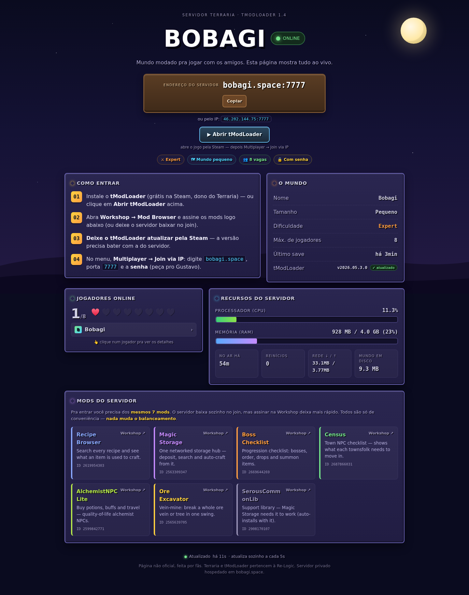

# terraria-status - página de status ao vivo pra servidor tModLoader

[English](README.md) · **Português**

Uma **página de status em Node.js sem dependências** pra servidor dedicado de Terraria
modado (**tModLoader**) rodando em Docker. Mostra, ao vivo e atualizando sozinha:

- 🟢 Servidor **online/offline**, uptime, reinícios
- 👥 **Jogadores online** (nomes, sem IPs) e vagas livres - **clique num nome pra abrir o modal do personagem** (veja abaixo)
- 📊 **CPU / RAM** do container do servidor, tráfego de rede, tamanho do mundo em disco
- 🗺️ Info do mundo (nome, tamanho, dificuldade, último save) e a **versão do tModLoader rodando**
- 🔺 **Aviso de desatualizado**: compara a versão rodando com a última stable no GitHub e sinaliza explicitamente quando o servidor está atrás
- 🏆 **Checklist de bosses** vinda do mod do servidor, visível mesmo com o servidor vazio
- 🧩 A **lista de mods** do servidor com links pra Steam Workshop
- 🎮 Botão **"Abrir tModLoader"** (`steam://run/1281930`) e endereço copiável

Exemplo no ar: **https://terraria.bobagi.space**



Feito como companheiro do
**[guia Terraria tModLoader Ubuntu Server](https://github.com/Bobagi/Terraria-tModLoader-Ubuntu-Server)** —
siga o guia primeiro pra ter o servidor rodando.

## Como funciona

```
jogadores ──HTTPS──▶ nginx ──▶ Node (127.0.0.1:3063) ──docker CLI──▶ container tmodloader
                               │  página estática + /api/status (JSON em cache)
                               └─ polling: docker stats/inspect · inject "playing" · du
```

- Um único `server.js` (zero pacotes npm) consulta o Docker em timers e mantém um snapshot
  JSON em cache; o navegador consulta `GET /api/status` a cada 5 s.
- Os jogadores online vêm do console do servidor: `docker exec <container> inject "playing"`
  e a resposta é lida com `tmux capture-pane` (a imagem JACOBSMILE roda o console num tmux).
  **Não** use `docker logs --tail` - fica lento conforme o log cresce.
- Roda **no host, não em container**, de propósito: precisa do CLI `docker`, e montar o
  `docker.sock` num container exposto à internet seria um risco bem maior.

## Rodar localmente (desenvolvimento / teste)

Não precisa de `npm install`: o app não tem nenhuma dependência. O front fica em
`public/`: `index.html` (marcação), `css/style.css`, `js/app.js` e `icons/icons.svg`
(veja [Ícones](#ícones)); o `server.js` serve tudo e o `/api/status`. Precisa de Node.js ≥ 18 (≥ 20 só pro build do mapa).

### Opção 1: GitHub Codespaces

1. Na página do repo: **Code → Codespaces → Create codespace on main**.
2. No terminal do Codespace:
   ```bash
   npm start
   ```
3. O Codespaces detecta a porta **3063** e mostra o aviso **Open in Browser**. Se não
   aparecer, abra a aba **Ports**, adicione `3063` e clique no ícone de globo.

### Opção 2: na sua máquina

```bash
git clone https://github.com/Bobagi/terraria-status.git
cd terraria-status
npm start            # http://127.0.0.1:3063
```

Porta ocupada? Escolha outra:

```bash
STATUS_PORT=3099 npm start                  # Linux / macOS / Git Bash
```

```powershell
$env:STATUS_PORT=3099; npm start            # Windows PowerShell
```

### O que esperar sem o servidor do jogo

Fora do VPS não existe o container `tmodloader` (e normalmente nem Docker), então a
página abre com o servidor **offline**: sem jogadores, sem CPU/RAM, sem dados no modal
do personagem. É esperado e o app não quebra: só deixa esses campos vazios. Layout,
cores, textos, lista de mods e o resto da página dá pra ajustar normalmente.

Também ficam faltando num clone novo (os dois estão no `.gitignore`):

- **`/mapa/`**: gere com `bash tools/terramap/build.sh` (veja [Mapa do mundo](#mapa-do-mundo-mapa)).
- **Sprites de itens/buffs** (`public/sprites/`): a página usa ícones simples no lugar (detalhes no [README em inglês](README.md#item-icons)).

### Fluxo de edição

- **`public/`** (`index.html`, `css/style.css`, `js/app.js`): salve e dê F5 no
  navegador. Os arquivos são lidos do disco a cada request, então não precisa reiniciar.
- **`server.js`** (ex.: o array `MODS`, padrões, endpoints): pare com `Ctrl+C` e rode
  `npm start` de novo.

### Ícones

Os ícones vêm do [Lucide](https://lucide.dev) (licença ISC), empacotados num sprite SVG
só, `public/icons/icons.svg`, com apenas os ícones que a página usa: nada de CDN de
ícone em produção. Use com
`<svg class="ic" aria-hidden="true"><use href="/icons/icons.svg#play"/></svg>` no HTML
ou `icon('play')` no `js/app.js`; o ícone herda a cor e o tamanho do texto em volta.
Pra adicionar um, coloque o nome do Lucide em `ICONS` no `tools/build-icons.mjs` e rode:

```bash
cd tools && npm install && node build-icons.mjs
```

### Testes automatizados

```bash
npm test             # node --test: parser do console, snapshot do mundo, world extras
```

## Requisitos

- O servidor tModLoader do guia (imagem JACOBSMILE; o helper `inject` + console em tmux
  vêm com ela)
- Node.js ≥ 18, um gerenciador de processo (PM2 no exemplo), nginx + certbot pra HTTPS

## Instalação

```bash
git clone https://github.com/Bobagi/terraria-status.git /opt/terraria-status
cd /opt/terraria-status

# ajuste a config (tabela abaixo) e:
pm2 start server.js --name terraria-status
pm2 save
```

Vhost do nginx (depois `certbot --nginx -d status.exemplo.com`):

```nginx
server {
    listen 80;
    server_name status.exemplo.com;
    location / {
        proxy_pass http://127.0.0.1:3063;
        proxy_set_header Host $host;
    }
}
```

## Configuração (variáveis de ambiente)

| Variável         | Padrão                                  | O que é                              |
|------------------|-----------------------------------------|--------------------------------------|
| `STATUS_PORT`    | `3063`                                  | Porta HTTP (mantenha atrás do nginx) |
| `STATUS_BIND`    | `127.0.0.1`                             | Bind - **mantenha localhost**        |
| `TMOD_CONTAINER` | `tmodloader`                            | Nome do container do servidor        |
| `TMOD_DATA_DIR`  | `/opt/terraria-tmodloader/data/tModLoader` | Volume de dados do servidor       |
| `TMOD_WORLD`     | `Bobagi`                                | Nome do mundo (arquivo `.wld`)       |
| `TMOD_WORLD_SIZE`| `Small`                                 | Exibido na página                    |
| `TMOD_DIFFICULTY`| `Expert`                                | Exibido na página                    |
| `TMOD_MAXPLAYERS`| `8`                                     | Vagas                                |
| `SERVER_HOST`    | `bobagi.space`                          | Endereço que os jogadores digitam    |
| `SERVER_IP`      | `150.230.85.106`                         | Endereço alternativo exibido         |
| `SERVER_PORT`    | `7777`                                  | Porta do jogo                        |
| `TMOD_EVENTS_FILE` | `<data>/serverevents.jsonl`        | Log de bosses/eventos escrito pelo mod |
| `DISCORD_WEBHOOK_URL` | (desligado)                         | Webhook do Discord; ou use o arquivo `discord-webhook.url` |
| `DISCORD_BACKFILL` | vazio                                  | `1` reenvia o log existente na primeira execução |

A **lista de mods** exibida é o array `MODS` no topo do `server.js` - edite pra bater com
o `TMOD_ENABLEDMODS` do seu servidor (nome, ID da Workshop, descrição de uma linha).

## Stats de personagem (opcional)

Clique no nome de um jogador e abre um modal. De cara ele mostra **quem** é e **há
quanto tempo** está online (tirado do console, sem precisar de mod).

Pra mostrar também **vida, mana, defesa, equipamentos, inventário e buffs**, rode o
mod server-side em [`character-stats-mod/`](character-stats-mod/) - **ele está ativo no
demo ao vivo**, e vem com um `.tmod` pré-buildado + build headless de um comando. Ele
grava `playerstats.json` na pasta de saves a cada poucos segundos e este app lê o arquivo.

Pontos-chave (detalhes no README do mod):

- É **`side = Server`** - **os jogadores NÃO precisam dele**, não entra na modlist
  obrigatória, e ninguém é kickado por não ter.
- Um servidor tModLoader puro expõe **só os nomes** pelo console; não há API nativa
  pros dados do personagem, e a **REST API do tShock é incompatível com tModLoader**.
  Um mod server-side é o único caminho.
- **"Level" não existe no Terraria** a não ser que você rode também um mod de RPG/nível.

Até o mod ser ativado, o modal mostra uma nota explicando isso - o site funciona
totalmente sem ele.

## Feed no Discord (opcional)

Manda mensagens temáticas para um canal do Discord por **webhook**: quando um boss morre, o canal recebe o
tempo da luta, o dano e o **DPS de cada jogador**, quem morreu e o que a vitória libera (Hardmode, Templo...);
Lua de Sangue, Eclipse, invasões e luas de Abóbora/Gelo quando começam e terminam; o **ranking da semana**
(domingo, 20h de Brasília: bosses derrotados, mais dano, maior DPS numa luta, mais mortes); e um aviso quando o
servidor cai, volta ou reinicia. **Não** avisa entrada e saída de jogadores.

```
tModLoader --(BossFights.cs)--> serverevents.jsonl --(discord-feed.js lê o fim)--> webhook --> Discord
```

- O mod continua offline: só acrescenta uma linha JSON por evento em `serverevents.jsonl`, ao lado do mundo.
  O app lê o arquivo, então a **URL do webhook (um segredo) fica só no host** e uma falha do Discord nunca
  chega ao servidor do jogo. Ao reiniciar, retoma do ponto salvo (`state/`) e **não** reenvia o histórico na
  primeira execução (`DISCORD_BACKFILL=1` reenvia).
- O **dano por jogador** não pode usar `OnHitByItem`/`OnHitByProjectile` num servidor dedicado (rodam no
  cliente que bateu). O mod lê o pacote de golpe (28), anota quem mandou e a vida do boss antes de o jogo
  processar, e mede a vida perdida logo depois. É exato (sem overkill, defesa já aplicada) e não exige nada
  no cliente. Bosses com partes (Gêmeos, Esqueletron, Destruidor, Lorde da Lua...) contam como uma luta.
  Dano contínuo (veneno, fogo) vai para quem acertou o boss por último.
- Boss que some ou derruba o grupo vira "luta perdida", com a vida que ele ainda tinha.

Configuração: no Discord, **Editar canal > Integrações > Webhooks > Novo webhook**, copie a URL e coloque em
`discord-webhook.url` ao lado do `server.js` (ignorado pelo git, `chmod 600`) ou em `DISCORD_WEBHOOK_URL`. Sem
URL o feed fica desligado. Recompile e reinstale o mod `StatusExport` (0.10+) e reinicie o app.

`GET /api/fights` devolve as últimas 20 mortes de boss (dano, DPS e mortes por jogador) para o site.


## Mapa do mundo (`/mapa/`)

`/mapa/` é um build próprio do [TerraMap Web](https://github.com/TerraMap/terramap.github.io) (MIT) que abre o mundo do servidor sozinho: pan, zoom, busca de minérios e baús, NPCs. Quem lê o mundo é o navegador; o `server.js` só entrega o último save completo em `/mapa/mundo.wld`, conferido a cada minuto (o `world-snapshot.js` recusa arquivo pela metade).

O build fica fora do git. Depois de um clone novo, ou para atualizar o TerraMap (troque `TERRAMAP_COMMIT`):

```bash
bash tools/terramap/build.sh   # precisa de git e Node >= 20
npm test                       # testes do arquivo de mundo
```

As nossas mudanças estão em `tools/terramap/serve-our-world.patch`: carrega o mundo do servidor, pt-BR e tema escuro por padrão, link de volta para o status, sem anúncio nem analytics do projeto original. O TerraMap lê só o `.wld`, então blocos de mods (guardados no `.twld`) não aparecem.

## Notas de segurança

- O log do console do tModLoader **contém a senha do servidor** (a imagem imprime a config
  no boot). Este app **nunca devolve linha crua de log** - extrai só nomes de jogador e
  **remove qualquer coisa que pareça IP** antes de publicar.
- A página nunca mostra a senha (diz "com senha"; o jogador pede pra você).
- Mantenha o Node em `127.0.0.1` e termine TLS no nginx.
- Caminhos malformados são rejeitados (sem traversal fora de `public/`, sem crash com
  percent-encoding inválido).

## Licença

[MIT](LICENSE)
